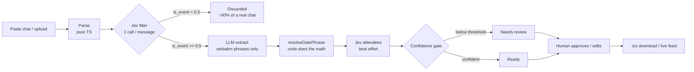

# Group Chat → Calendar

Paste a family or friends group-chat export and get back a **reviewed calendar**: WhatsApp exports (or plain `Name: text` lines) go in, an `.ics` file or a live ICS feed comes out.

**Jev filters, the LLM copies phrases, code computes dates, a human approves.**

## Overview

1. **Parse** (pure TypeScript) — detects WhatsApp bracket style (`[10/3/26, 7:41 PM] Mom: …`), WhatsApp dash style (`10/3/26, 19:41 - Mom: …`), or plain `Name: text` lines (with a "first message date" picker). Multi-line messages stay together. Output is `{id: "M001", sent_at, sender, text}`; members are the distinct senders.
2. **Jev filter** — one cheap Jev request per message decides `is_event` (Noul probability) and `kind` (new_event / deadline / change / cancellation / rsvp / none / uncertain). Messages below 0.5 never reach the LLM.
3. **LLM extract** — only the kept messages (plus 2 messages of context each) go to the LLM (`gpt-6-luna`), which copies `date_phrase`, `time_phrase` and `end_time_phrase` **verbatim** with a title and kind. It never resolves dates.
4. **Resolve** (pure TypeScript) — `resolveDatePhrase()` in `src/lib/dateResolver.ts` turns the verbatim phrases into a date and time against the message's own `sent_at`, flags anything ambiguous, and sets confidence.
5. **Jev attendees** — best effort: who said they're coming.
6. **Review** — a human approves, edits, merges, or rejects. Events below the confidence slider (default 0.6) or unresolved land in "Needs review".
7. **Export** — `.ics` download or a public `webcal://` feed URL.

## Pipeline



## Why the work is split this way

- **A cheap Jev filter before the LLM.** A real group chat is 90% noise ("ok", "lol", memes). Running every message through a frontier LLM is wasteful; Jev costs ~$0.0000105 per message. The export panel shows Jev's actual cost against an estimated all-LLM cost, with editable constants.
- **Code does all date math.** Neither Jev nor the LLM resolves dates. Jev mixed up "next Tuesday" and "tomorrow" when asked for date parts, so that stage is gone: the LLM only copies the words, and `resolveDatePhrase()` does the calendar work in deterministic, unit-tested code.
- **A confidence-gated review lane.** Extraction is probabilistic, so the pipeline ends at a human: green ≥ 0.8, amber 0.6–0.8, red < 0.6 or unresolved. Bulk "Approve all ≥ 0.8" keeps the human in the loop without grinding.

## Setup

```bash
# schema + security migrations
supabase db push

# optional: AI keys. Without them every run uses offline mode.
supabase secrets set TYPESAFE_API_KEY=... OPENAI_API_KEY=...

# deploy functions (verify_jwt settings come from supabase/config.toml)
supabase functions deploy jev
supabase functions deploy extract-events
supabase functions deploy chat-store
supabase functions deploy ics-feed

npm install
npm run dev
```

## Security model

There is no sign-in; the anon key is public. So:

- **Read-only anon key.** RLS keeps SELECT on `chats`, `messages`, `events` and `jev_calls` but there are no anon insert/update/delete policies, and those privileges are revoked. `chats.feed_slug` and `chats.write_token_hash` are not readable by anon.
- **Writes go through `chat-store`** (service-role client) with whitelisted actions: `create_chat`, `save_messages`, `update_message_labels`, `log_jev_calls`, `save_events`, `update_event` (only status, title, date/time, location, user_note). `create_chat` returns a random write token, kept in memory by the browser; the server stores only its SHA-256 hash and every other action must present it.
- **Daily AI cap.** `jev` and `extract-events` call `increment_usage()` (service role only) before **every** upstream fetch, retries included. The cap is 200 calls/day for the whole app. Over the cap: 429. Counter error, null result, missing or rejected key: 503. Both carry `rate_limited: true`, and the app switches to offline mode with a notice.
- **No request-controlled config.** No function takes a Supabase URL, key, model or base URL from the request. `jev` only runs the filter and attendees question sets; it builds the questions itself. Every function caps request size.
- **JWT.** `jev`, `extract-events` and `chat-store` have `verify_jwt = true` (the client sends the anon key as Bearer). `ics-feed` is public so calendar apps can subscribe, but it is read-only, calls no AI, and only serves the chat named by its unguessable 128-bit slug.

## Environment variables

| Variable | Where | Purpose |
| --- | --- | --- |
| `TYPESAFE_API_KEY` | Edge Function secret | Jev API key (server-side only, never in the browser). Optional: missing means offline mode |
| `OPENAI_API_KEY` | Edge Function secret | LLM extractor key. Optional: missing means offline mode |
| `OPENAI_BASE_URL` | Edge Function secret | Optional; defaults to `https://api.openai.com/v1` |
| `OPENAI_MODEL` | Edge Function secret | Optional; defaults to `gpt-6-luna` |
| `VITE_SUPABASE_URL` | `.env` / client | Supabase project URL |
| `VITE_SUPABASE_ANON_KEY` | `.env` / client | Supabase anon key |

## Screenshots


## Tests

```bash
npm test                 # vitest
npm run test:functions   # edge-function handler tests (needs Deno)
```

Covers the chat parser (three formats, multi-line messages), the date resolver ("next Tuesday" sent on Sunday/Monday/Wednesday, "tomorrow" across midnight and month/year ends, times in a separate clause, ranges, PM context, impossible dates, out-of-range years, weekday/date conflicts), the ICS generator (CRLF, 75-octet folding, escaping, deadlines + VALARM, timed deadlines, cancellations, stable UIDs, TZID/VTIMEZONE emission), and the offline fallback path (chatter rejection, short titles, weekday/date mismatch flagging, same-time carry-over). The Deno tests drive the real edge-function handlers with a stubbed network: every retry counted, fail-closed counter, refused client questions/model/URLs, size caps, chat-store write tokens and field whitelist, read-only feed. The E2E script (`npx tsx scripts/e2eTest.ts`) runs the bundled samples through the deployed pipeline and checks that the anon key can no longer write; once the shared 200-calls-per-day cap is hit the pipeline falls back to offline mode automatically.

## Design decisions

- **Per-message reference date.** Each message's own `sent_at` is "today" for its relative dates — taken as the message's calendar day in the chat's timezone, not the viewer's — so "tomorrow" in a Tuesday message means Wednesday — even if you paste the export a week later. Members who chatted across timezones still resolve locally to each message's frame.
- **Timezone-aware exports.** Timed events carry the chat's timezone via `TZID` (with a matching `VTIMEZONE` block), so a "4 PM" from the chat stays 4 PM in any calendar app instead of shifting. Date-only deadlines and all-day events use `VALUE=DATE` with no invented time. The live `ics-feed` function and the `.ics` download behave identically.
- **Two kinds of notes.** Internal resolution explanations ("bare time — assumed PM") stay in the review board; only user-facing remarks (`user_note`) are written into ICS `DESCRIPTION` fields.
- **Mismatch dates are flagged, never guessed.** If a date phrase names a weekday and a day number that disagree ("Saturday the 15th"), the event goes to review with no date. A change message saying "same time" inherits the time of the event it moves; "same place" inherits the location.
- **Date rules, in code.** today/tonight = the message day; tomorrow = +1; day after tomorrow = +2; a bare or "this" weekday = the next one on or after the message day; "next Tuesday" = Tuesday of the following Mon–Sun week; a month and day with no year = the next upcoming one. A day of the month without a month ("the 20th") is filled in as the next one coming up and sent to review.
- **Ambiguity is flagged, never guessed.** Alternatives ("Friday or Saturday"), vague phrases ("this weekend"), relative words that disagree with a stated date, and date words that aren't in the message verbatim all land in review. If the LLM copies only part of a date ("next Wednesday" from "next Wednesday Oct 21"), the resolver reads the whole verbatim expression around it.
- **Times are parsed in code and never dropped.** From `time_phrase` first, then the whole message: "7pm", "7:30", "noon", "at 7", "7-9pm", "11:30 to 1". A time elsewhere in the message is taken only when it is nearer this event's date than any other date ("practice next Tuesday at 5, permission slip due Friday" keeps Friday all-day). Tonight/evening/dinner + bare hour = PM, morning = AM; otherwise bare 1–6 is assumed PM and 7–11 AM, with a note and lower confidence. Only events with no time are all-day.
- **`none` / `uncertain` in every Choice.** Following Jev guidance for the filter: atomic literal questions, a `none`/`uncertain` option in every Choice, small states. This keeps confidence meaningful — a model forced to pick between bad options returns confident nonsense.
- **Fuzzy linking and dedupe in code.** Changes and cancellations link to the earlier event by word-Jaccard ≥ 0.5 on titles; events with the same date and similar titles are deduped, keeping the higher-confidence one.
