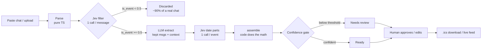

# Group Chat → Calendar

Paste a family or friends group-chat export and get back a **reviewed calendar**: WhatsApp exports (or plain `Name: text` lines) go in, an `.ics` file or a live ICS feed comes out.

**Jev filters and reads, code computes, the LLM extracts, a human approves.**

## Overview

1. **Parse** (pure TypeScript) — detects WhatsApp bracket style (`[10/3/26, 7:41 PM] Mom: …`), WhatsApp dash style (`10/3/26, 19:41 - Mom: …`), or plain `Name: text` lines (with a "first message date" picker). Multi-line messages stay together. Output is `{id: "M001", sent_at, sender, text}`; members are the distinct senders.
2. **Jev filter** — one cheap Jev request per message decides `is_event` (Noul probability) and `kind` (new_event / deadline / change / cancellation / rsvp / none / uncertain). Messages below 0.5 never reach the LLM.
3. **LLM extract** — only the kept messages (plus 2 messages of context each) go to the LLM, which must copy `date_phrase` **verbatim** and is forbidden from resolving dates.
4. **Jev date parts** — one request per event. Jev reads seven Choice answers (mode, month, day, year, day_anchor, weekday, week_offset) plus `meridiem`; code does **all** the date math.
5. **Resolve** (pure TypeScript) — `assemble()` turns the parts into a real date, flags the impossible, and gates confidence.
6. **Review** — a human approves, edits, merges, or rejects. Events below the confidence slider (default 0.6) or unresolved land in "Needs review".
7. **Export** — `.ics` download or a public `webcal://` feed URL.

## Pipeline



## Why the work is split this way

- **A cheap Jev filter before the LLM.** A real group chat is 90% noise ("ok", "lol", memes). Running every message through a frontier LLM is wasteful; Jev costs ~$0.0000105 per message. The export panel shows Jev's actual cost against an estimated all-LLM cost, with editable constants.
- **Jev reads parts, code does date math.** Jev never computes, counts, or compares dates — every date question is an atomic literal choice, and `assemble()` does the calendar work in deterministic code. Code can be unit-tested; date math asked of a model cannot be trusted.
- **A confidence-gated review lane.** Extraction is probabilistic, so the pipeline ends at a human: green ≥ 0.8, amber 0.6–0.8, red < 0.6 or unresolved. Bulk "Approve all ≥ 0.8" keeps the human in the loop without grinding.

## Setup

```bash
# secrets for the Edge Functions (set once)
supabase secrets set TYPESAFE_API_KEY=... OPENAI_API_KEY=...

# deploy functions
supabase functions deploy jev
supabase functions deploy extract-events
supabase functions deploy ics-feed

npm install
npm run dev
```

No auth: this is a single public demo workspace. Schema lives in `supabase/migrations` and RLS uses permissive anon policies for the demo.

## Environment variables

| Variable | Where | Purpose |
| --- | --- | --- |
| `TYPESAFE_API_KEY` | Edge Function secret | Jev API key (server-side only, never in the browser) |
| `OPENAI_API_KEY` | Edge Function secret | LLM extractor key (falls back to a mock/regex extractor if missing) |
| `OPENAI_BASE_URL` | Edge Function secret | Optional; defaults to `https://api.openai.com/v1` |
| `OPENAI_MODEL` | Edge Function secret | Optional; defaults to `gpt-6-luna` |
| `VITE_SUPABASE_URL` | `.env` / client | Supabase project URL |
| `VITE_SUPABASE_ANON_KEY` | `.env` / client | Supabase anon key |

## Screenshots


## Tests

```bash
npx vitest run
```

Covers the chat parser (three formats, multi-line messages), the date resolver (relative anchors, "next Tuesday", impossible dates, out-of-range years, minimum-part confidence), the ICS generator (CRLF, 75-octet folding, escaping, deadlines + VALARM, cancellations, stable UIDs, TZID/VTIMEZONE emission), and the offline fallback path (chatter rejection, short titles, weekday/date mismatch flagging, same-time carry-over). The E2E script (`npx tsx scripts/e2eTest.ts`) runs the bundled samples through the live pipeline; both edge functions count against a shared 200-calls-per-day cap tracked in the database, and once it's hit the pipeline falls back to offline mode automatically.

## Design decisions

- **Per-message reference date.** Each message's own `sent_at` is "today" for its relative dates — taken as the message's calendar day in the chat's timezone, not the viewer's — so "tomorrow" in a Tuesday message means Wednesday — even if you paste the export a week later. Members who chatted across timezones still resolve locally to each message's frame.
- **Timezone-aware exports.** Timed events carry the chat's timezone via `TZID` (with a matching `VTIMEZONE` block), so a "4 PM" from the chat stays 4 PM in any calendar app instead of shifting. Date-only deadlines and all-day events use `VALUE=DATE` with no invented time. The live `ics-feed` function and the `.ics` download behave identically.
- **Two kinds of notes.** Internal resolution explanations ("bare time — assumed PM") stay in the review board; only user-facing remarks (`user_note`) are written into ICS `DESCRIPTION` fields.
- **Mismatch dates are flagged, never guessed.** If a date phrase names a weekday and a day number that disagree ("Saturday the 15th"), the event goes to review with no date. A change message saying "same time" inherits the time of the event it moves; "same place" inherits the location.
- **Years restricted to candidates found in the text.** Instead of letting a model pick any year, the `year` question's choices are only year-like numbers found in the message, plus the message year and the next year, `none`, and `out_of_range`. Anything else is flagged, never guessed.
- **`none` / `uncertain` in every Choice.** Following Jev guidance: atomic literal questions, a `none`/`uncertain` option in every Choice, small states. This keeps confidence meaningful — a model forced to pick between bad options returns confident nonsense.
- **Minimum-part confidence.** A resolved date is only as strong as its weakest used part: `confidence = min(confidence of parts actually used)`. Bars in the review card show the full probability distribution per part.
- **The "Black Friday" example.** Asked "which weekday does this name?", Jev answered `Friday` (0.85) for the phrase "Black Friday" — a holiday, not a weekday. This is why code only reads `weekday` when `day_anchor = weekday` and gates on confidence ≥ 0.6.
- **Bare times default to PM in code.** When `meridiem = none_stated`, hours 1–6 are bumped to PM (flagged for review); "pickup at 3?" lands in review, not silently at 3 AM.
- **Fuzzy linking and dedupe in code.** Changes and cancellations link to the earlier event by word-Jaccard ≥ 0.5 on titles; events with the same date and similar titles are deduped, keeping the higher-confidence one.
